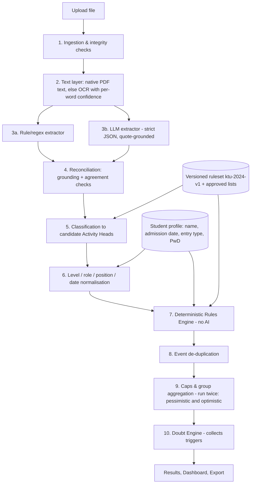

# KTU Activity Points Checker — Product & Engineering Specification

**Document version:** 1.0 · **Date:** 26 Nov 2026
**Rule source:** *APJ Abdul Kalam Technological University — Activity Points Handbook, 2024 Scheme (B.Tech, B.Des, BBA, BCA)*
**Ruleset ID:** `ktu-2024-v1`

---

## 0. How to read this document

| Part | What it covers |
|---|---|
| §1 | The accuracy contract — what "100% accurate" can and cannot mean |
| §2–3 | Scope, users, core flows |
| §4 | The handbook rules the system must enforce (summary) |
| §5 | Verdict model (Verified / Doubt / Not Eligible / Manual) |
| §6–7 | Architecture and stage-by-stage pipeline |
| §8 | **Doubt Register** — every condition that must raise a flag |
| §9 | **Handbook Ambiguity Register** — places where the handbook itself is unclear |
| §10 | Data model and JSON schemas |
| §11–12 | API and UI/UX |
| §13 | Security, privacy, anti-fraud |
| §14 | Testing and how accuracy is *measured* |
| §15–17 | Tech stack, roadmap, open questions |
| Appendix A | Full rule catalogue (every row of Table 2 of the handbook) |
| Appendix B | Worked examples |

---

## 1. The accuracy contract

### 1.1 Honest starting point

No system that **reads certificates** (scans, photos, PDFs with different layouts, 200+ issuers) can be *mathematically* 100% accurate. OCR misreads, certificates omit information, issuers use unusual wording, and forged certificates look identical to real ones.

So the requirement is re-stated as something that **can** be guaranteed by design:

> **The system must never present an uncertain result as a certain one.**
> Anything that is not provably certain is shown with an explicit **DOUBT** flag, the reason, and the point range it could resolve to.

This turns "100% accurate" into two checkable guarantees:

| # | Guarantee | How it is achieved |
|---|---|---|
| G1 | **The arithmetic is 100% correct** (rules, levels, caps, dedupe, group totals). | Deterministic rules engine. No AI is allowed to compute points. Exhaustively unit/property tested. |
| G2 | **No silent errors in reading certificates.** A result is labelled `VERIFIED` only if *every* hard check passes. Any soft signal → `DOUBT`. | Evidence-grounded extraction, dual extraction, doubt triggers (§8), calibrated thresholds (§14). |

### 1.2 What "VERIFIED" does and does not mean

`VERIFIED` means: *"The certificate text, as read by the system, satisfies the handbook rule with no detected uncertainty."*

It does **not** mean:

- the certificate is authentic (the system cannot prove authenticity unless there is a verifiable QR/URL — see §13.3);
- the SFA / College / KTU portal has accepted it (they are the final authority — handbook §1 and rule viii);
- that institution-level quotas are respected (e.g. "max 8 students per magazine per year").

This disclaimer must appear on every results screen and every export.

### 1.3 The 0.1% rule

The requirement "if there is even 0.1% doubt, specify it" is implemented in two ways:

1. **Rule-based (primary):** any unmet hard check, any missing field, any disagreement between extractors → `DOUBT`. No probability needed.
2. **Statistical (secondary):** for any model-produced score, the threshold for `VERIFIED` is set so that the *measured* error rate of `VERIFIED` items on a held-out labelled set is **< 0.1 %** (see §14.3, including the "rule of three" sample-size requirement).

Model self-reported confidence ("I'm 99% sure") is **never** used as evidence on its own.

### 1.4 Final authority

The tool is a **self-assessment and preparation aid** that also produces an *Activity Points File* for the SFA (handbook rule viii). It does not replace SFA verification or the KTU portal upload.

---

## 2. Scope

### 2.1 In scope (v1)

- B.Tech, B.Des, BBA, BCA students on the **2024 scheme**.
- Upload of certificates (PDF, JPG, PNG, HEIC) with per-file analysis.
- Mapping each certificate to a handbook Activity Head (rows 1.1 – 3.17).
- Computation of confirmed points, pending (doubtful) points, and the 3-group / 3-credit status.
- Lateral-entry (90 / 30 per group) and PwD (60 / 20 per group) thresholds.
- Export of a per-semester *Activity Points File* (PDF + CSV).

### 2.2 Out of scope (v1)

- Submission to the KTU portal.
- Replacing SFA / college verification.
- Other schemes (2015/2019 etc.) — but the rules engine is **versioned** so they can be added (§10.1).
- Judging whether a certificate is *forged* beyond the signals in §13.3.

---

## 3. Users and core flows

| User | Goal |
|---|---|
| Student | Know how many points are safely counted, what is doubtful, and what is still missing per group. |
| SFA / Faculty (later phase) | Review a student's file with every doubt already listed and linked to evidence. |
| Admin (rules owner) | Maintain rulesets, approved-course lists, NIRF/institution lists. |

### 3.1 Student flow

1. Sign up → enter **profile facts the handbook depends on**: full name (as on certificates), programme (B.Tech/B.Des/BBA/BCA), **admission date / batch**, entry type (regular / lateral), PwD status, programme end date.
2. Upload certificates (batch).
3. For each file the system returns a **Certificate Card**: extracted facts with highlighted source evidence, matched rule(s), points, verdict, and doubts.
4. Student resolves doubts (answer a question, upload a clearer file, choose between candidate rules, or mark "ask SFA").
5. Dashboard shows per-group progress with **Confirmed / Pending / Upper-bound** numbers.
6. Export the Activity Points File.

---

## 4. The handbook rules the system must enforce

### 4.1 Requirements

| Student type | Total min. | Per-group min. | Credits |
|---|---|---|---|
| Regular | **120** | **40 in each of Groups I, II, III** | 3 (1 per group) |
| B.Tech Lateral Entry | **90** | **30 in each group** | 3 |
| PwD | **60** | **20 in each group** | 3 |

Activity Points/Credits are **not** counted in SGPA/CGPA. Degree is withheld until the minimum is met (rule v).

### 4.2 General rules (handbook §2) → system behaviour

| Rule | Handbook text (paraphrased) | System behaviour |
|---|---|---|
| i | Participation and winning points cannot be combined for the same event; only the highest level of achievement counts. | Event-identity dedupe (§7.8): one event → one outcome → highest level/position only. If two certificates *might* be the same event → `DOUBT` (D-DUP). |
| ii | Every activity has a maximum; no claiming beyond it. | Cap engine applies per-item and per-category caps (§7.9). |
| iii | Points depend on merit, level (College/Zonal/State/National/International), and certification/verification compliance. | Level detection (§7.6) + evidence-issuer checks (§7.7). |
| iv–v | 3 credits are mandatory for the degree. | Credit status panel. |
| vi | Only activities **during the period of study** count; pre-admission certificates don't. | Date check against student's admission → programme end window (R-01/R-02). |
| vii | Fake/fraudulent documents → points cancelled, disciplinary action. | Fraud warning banner; authenticity signals (§13.3). |
| viii | Student maintains a personal Activity Points File each semester, verified by SFA. | Export feature (§11.4). |

### 4.3 Level scale

`Level 1 = College · Level 2 = Zonal · Level 3 = State · Level 4 = National · Level 5 = International`

---

## 5. Verdict model

### 5.1 Per-certificate verdicts

| Verdict | Badge | Meaning | Counts toward |
|---|---|---|---|
| **VERIFIED** | ✅ | All hard checks pass; extractors agree; exactly one rule matches; no ambiguity flag (§9) touches it. | Confirmed points |
| **DOUBT** | ⚠️ | At least one doubt trigger fired (§8). Shows reason code(s), how to resolve, and `[min, max]` point range. | Pending points only |
| **NOT ELIGIBLE** | ❌ | Definitively fails a handbook clause (cites the clause), e.g. before admission date, IELTS *General Training*, score below lowest tier. | Nothing |
| **MANUAL ONLY** | 🔍 | Category cannot be judged by software (needs SFA/HoD/committee certification — e.g. 3.1, 3.2). Student can *log* it. | Nothing (listed as "to be verified by SFA") |

### 5.2 Point buckets (the three numbers shown everywhere)

| Bucket | Definition |
|---|---|
| **Confirmed** | Engine run with *only* `VERIFIED` items (all `DOUBT` items treated as 0). A safe lower bound. |
| **Upper bound** | Engine run with every `DOUBT` item at its *maximum possible* outcome (subject to all caps/dedupe). A safe upper bound. |
| **Pending** | `Upper bound − Confirmed`. |

> The bounds are **not predictions**. They are guaranteed brackets: the true total (after SFA review) is expected to lie in `[Confirmed, Upper bound]` assuming the ruleset itself is correct. If a doubt could resolve to `NOT ELIGIBLE`, its minimum is 0.

---

## 6. Architecture



### 6.1 Non-negotiable design principles

1. **AI reads, code decides.** LLM/OCR may only *extract facts*. Mapping facts → points is plain code reading a data file.
2. **Evidence or it didn't happen.** Every extracted field carries `{page, bbox, verbatim_quote}`. If the quote is not found in the text layer by exact/normalised string match → `E-02` doubt.
3. **Two independent readings must agree** for every critical field (regex extractor vs LLM extractor). Disagreement → `E-03` doubt.
4. **Default is DOUBT**, not VERIFIED. A certificate must *earn* `VERIFIED`.
5. **Ranges, not guesses.** Doubtful items carry a min/max, never a midpoint.
6. **Rules are data.** Points tables live in versioned JSON (Appendix A / §10.1), reviewed by a human against the handbook, with a checksum.
7. **Doubts are only cleared by** (a) the student supplying missing data, (b) a better document, or (c) a human reviewer — **never by the model re-thinking it**.
8. **Fail closed.** Any engine invariant failure (e.g., a group total exceeds the sum of caps) blocks results with `S-03`.

---

## 7. Pipeline specification

### 7.1 Stage 1 — Ingestion & integrity

| Check | Pass condition | Otherwise |
|---|---|---|
| File type & size | PDF/JPG/PNG/HEIC, ≤ 15 MB, ≤ 10 pages | Reject with message |
| Readable | Not corrupt / not password-protected | `Q-06` (reject, ask for new file) |
| Hash | SHA-256 stored | Duplicate upload by same student → `F-04` |
| Page completeness | Page count matches page-numbering text ("Page 1 of 2") if present | `Q-05` |
| Image quality | Effective ≥ 200 DPI at A4; blur score above threshold; skew < 5° | `Q-01`/`Q-02` |

### 7.2 Stage 2 — Text layer

1. **Native PDF text first** (PyMuPDF / pdfplumber): exact characters, no OCR error. Mark `source = "native"`.
2. If no/low text layer → **OCR** (Tesseract and/or PaddleOCR) after OpenCV pre-processing (deskew, denoise, binarise). Store **per-word confidence**.
3. Languages: English + Malayalam (+ Hindi/Tamil optionally). Non-English critical text → `E-07`.
4. Keep QR codes: decode with `pyzbar`/OpenCV; store URL/payload.

### 7.3 Stage 3 — Extraction (two independent paths)

**Fields to extract (superset):**

| Field | Notes |
|---|---|
| `recipient_name` | Compare with profile (see §7.4) |
| `issuer_name`, `issuer_type` | e.g. college, KTU, IIT, NSS Cell, Fire & Rescue, Govt. blood bank |
| `activity_title`, `event_name` | |
| `activity_type_phrases` | "participated", "winner", "first prize", "volunteer" etc. (verbatim) |
| `position` | 1st/2nd/3rd/none/special mention |
| `team_or_individual` | needed for 1.2 vs 1.3 |
| `level_phrases` | "State level", "National", "inter-collegiate", "zonal" (verbatim) |
| `start_date`, `end_date`, `issue_date` | ISO-8601 + original string |
| `duration` | days / hours / weeks / months if stated |
| `scores` | TOEFL/IELTS/PTE/GRE/GATE/CAT/GMAT numbers + test type/module |
| `signatories`, `seals_present` | roles of signers |
| `verification_url`, `certificate_id` | for authenticity check |

**Path A — Deterministic extractor:** regex + keyword + layout rules per issuer pattern (IELTS TRF, TOEFL, NPTEL, Coursera, NSS, etc.).
**Path B — LLM extractor:** temperature 0, JSON-schema-constrained output. Prompt must demand `{value, quote}` for every field and `null` when absent. *It may not infer.*

### 7.4 Stage 4 — Reconciliation

For each critical field:

1. **Grounding:** `quote` must exist in the text layer (normalised for whitespace/case/hyphenation). Fail → `E-02`.
2. **Agreement:** Path A value == Path B value after normalisation. Fail → `E-03`.
3. **Uniqueness:** exactly one candidate value in the document (not two different dates, two names). Fail → `E-04`.
4. **Name match:** normalise (case, punctuation, honorifics, initials expansion *not* automatic). `VERIFIED` requires an exact normalised match with the profile name **or** a student-approved alias list. Fuzzy match → `E-05` (shows the exact difference).
5. **Dates:** if `dd/mm` vs `mm/dd` is ambiguous (both ≤ 12) and no month name is present → `E-06`.
6. **OCR-sourced critical fields:** each character-confidence must exceed the threshold (calibrated, §14.3); else `Q-03`.

> **Critical fields** are those that change the points or eligibility: recipient name, event/activity type, position, level, dates, score values, issuer, duration.

### 7.5 Stage 5 — Classification to Activity Head

- A **deterministic keyword/pattern classifier** proposes **candidate rule IDs** (e.g., `["2.1","2.3","2.5"]`).
- `VERIFIED` requires **exactly one** candidate that satisfies all *mandatory conditions* of that rule (issuer type, duration, event type).
- 0 candidates → `C-02` (no matching rule — never silently 0 points).
- ≥ 2 candidates → `C-01`; student is shown the candidates **with the points each would give** and must choose; a student choice still yields `DOUBT` (ask SFA) unless the other candidates are objectively excluded by a hard check.

### 7.6 Stage 6 — Level detection

| Level | Accepted explicit evidence (examples) |
|---|---|
| 1 College | "intra-college", host is the student's own college |
| 2 Zonal | "KTU zone", "zonal" (explicit) |
| 3 State | "State level", "Kerala State", organised by State Govt/State body |
| 4 National | "National level", "All India", Central Govt body |
| 5 International | "International", participants from multiple countries stated |

Rules:
- **Level must be stated or unambiguously implied by the issuer** (e.g. Smart India Hackathon grand finale = National per handbook 3.15 examples). "Inter-college", "open to all colleges", "regional" are **not** levels → `C-03`.
- When two levels are plausible, the min is used for *Confirmed* and the max for *Upper bound*.

### 7.7 Stage 7 — Eligibility checks (per rule)

All checks are code. Each returns `PASS`, `FAIL` (→ NOT ELIGIBLE) or `UNKNOWN` (→ DOUBT).

| Check | Rule basis |
|---|---|
| Activity date ∈ [admission_date, programme_end] | Rule vi; 1.5; 2.21 ("tests during original programme duration") |
| Issuer matches the rule's accepted issuers | Evidence column per row |
| Required co-signature present | e.g. 1.8 blood donation: blood-bank certificate **and** recommendation by NSS PO/University NSS Cell; 3.1/3.2 SFA/HoD |
| Minimum duration met | 1.20 (≥ half-day), 1.12 (100 h), 1.17 (≥ 10 days / 50 h), 2.14 (≥ 6 days), 2.20 (≥ 2 weeks / 10 working days), 3.3 (≥ 3.5 months), 1.9 (≥ 5 days/semester), 2.15/2.16/2.17/2.18 (≥ 1 academic year) |
| Test type exact | 2.21: TOEFL **iBT**, IELTS **Academic**, PTE **Academic**, BEC levels; 2.22: GRE/GATE/CAT/GMAT |
| Score tier | Contiguous tiers from Appendix A; below lowest tier → **0 points, VERIFIED-as-zero** (not a doubt) |
| Approved-list membership | 3.17 skilling (course must be on University list); NIRF Top-100 / IIT/NIT list for 2.5–2.8 |
| Excluded sources | 2.5 excludes college-fest events (e.g. Ragam) |

### 7.8 Stage 8 — Event de-duplication (rule i)

- Compute an **event fingerprint**: normalised `(event_name, organiser, start_date, level)`.
- Same fingerprint → keep **one** outcome: *winner beats participation*, *higher level beats lower*.
- Near-match (fuzzy name similarity above threshold or overlapping dates, same organiser) but not identical → `D-DUP` doubt; both items marked pending; Upper bound counts only the better one.

### 7.9 Stage 9 — Cap and aggregation engine

Order of operations (fixed, documented, tested):

1. Per-item scoring.
2. Per-event dedupe (7.8).
3. Per-year / per-semester / per-event limits (e.g. 1.4 → 5 per magazine per AY; 1.9 → 10/semester; 1.23/1.24 → 5 per AY).
4. **Sub-head cap** (e.g. 1.8 blood donation max 10).
5. **Category cap** (e.g. NSS/NCC 1.11–1.19 max 40).
6. **Group total** and credit-eligibility test against the student's threshold.

Run **twice** (pessimistic / optimistic, §5.2). Because all caps are monotone, `Confirmed ≤ true ≤ Upper bound`. A property test must assert this for random inputs (§14.2).

If the handbook's cap placement is ambiguous (§9), compute with **both** readings; if results differ, show the difference as a doubt (`S-02`).

### 7.10 Stage 10 — Doubt Engine

Collects all triggers from all stages, de-duplicates, attaches (a) human-readable reason, (b) the exact evidence (highlighted region), (c) "how to resolve", (d) impact on points range. See §8.

---

## 8. Doubt Register (all conditions that must raise a flag)

A result is `DOUBT` if **any** row below fires for it.

### 8.1 Document quality

| Code | Trigger | Student message | Resolve by |
|---|---|---|---|
| Q-01 | Low resolution | "Text is too small to read reliably." | Upload higher-resolution scan |
| Q-02 | Blur / skew / glare / cropped edges | "Part of the certificate may be cut off or blurred." | Re-scan flat, full page |
| Q-03 | OCR confidence below threshold on a critical field | "Could not read '<field>' with certainty (read as '<value>')." | Upload native PDF or confirm value |
| Q-04 | Handwriting on a critical field | "Handwritten text can't be read reliably." | Manual SFA check |
| Q-05 | Missing pages | "Page 2 of 2 not found." | Upload all pages |
| Q-06 | Corrupt / password-protected | "File can't be opened." | Re-upload |

### 8.2 Extraction

| Code | Trigger |
|---|---|
| E-01 | A critical field is missing from the document |
| E-02 | Extracted quote not found in text layer (possible hallucination) |
| E-03 | Regex extractor and LLM extractor disagree |
| E-04 | Multiple conflicting candidate values (two dates, two scores, two names) |
| E-05 | Recipient name differs from profile (any difference after normalisation) |
| E-06 | Date format ambiguous (dd/mm vs mm/dd) |
| E-07 | Critical text in a language not covered by the extractor |

### 8.3 Classification & interpretation

| Code | Trigger |
|---|---|
| C-01 | More than one rule could apply |
| C-02 | No rule applies (activity not listed in handbook) |
| C-03 | Level not explicitly stated ("inter-college", "regional", "open") |
| C-04 | Position/role ambiguous ("runner-up", "finalist", "top 10") |
| C-05 | Prize type not in handbook table ("special mention", "consolation") |
| C-06 | Individual vs group event cannot be determined (1.2 vs 1.3) |
| C-07 | Institution class unknown (is the host in NIRF Top 100 / IIT/NIT/IIIT/Central Univ.?) |

### 8.4 Eligibility

| Code | Trigger |
|---|---|
| R-01 | Activity date outside study period → actually **NOT ELIGIBLE** if date is certain; `DOUBT` if date uncertain |
| R-02 | No activity date on certificate (issue date ≠ activity date) |
| R-03 | Required duration not stated or not provable |
| R-04 | Issuer is not one of the accepted issuers for that row |
| R-05 | No signature/seal where the row demands an authority |
| R-06 | Required second authority missing (e.g. NSS PO recommendation for blood donation) |
| R-07 | Approved-course list not loaded / course not found (3.17) |
| R-08 | Institution-level quota can't be verified (max 8 editors, 1 class rep per class, max 2 coordinators, ≥1 female coordinator, class strength ≥ 30) |
| R-09 | Test variant doesn't match the handbook (IELTS General Training, TOEFL Home Edition, etc.) |
| R-10 | Score validity unknown (e.g. GATE valid-score window) |

### 8.5 Authenticity

| Code | Trigger |
|---|---|
| F-01 | No verifiable QR/ID/URL available |
| F-02 | Verification link/ID checked and failed or mismatched |
| F-03 | PDF metadata/visual tamper signals (soft only) |
| F-04 | Same file or near-identical content uploaded twice |

### 8.6 Ruleset / system

| Code | Trigger |
|---|---|
| S-01 | Student's scheme ≠ ruleset (e.g. admitted before 2024 scheme) — **blocking** |
| S-02 | Result depends on a handbook ambiguity (§9) |
| S-03 | Engine invariant violation — **blocking** |

> **UI rule:** Every `DOUBT` must show the code, a plain-English sentence, the exact snippet/region, and the **points range** (e.g. "Could be 0 – 25 points").

---

## 9. Handbook Ambiguity Register

While reading the handbook, these inconsistencies / unclear spots were found. They must be resolved with KTU/SFA/Dean (Academic) in writing (§17) and until then the system uses the **conservative** handling shown and raises `S-02`.

| ID | Where | Issue | Conservative handling until clarified |
|---|---|---|---|
| A-01 | Page 1 summary table vs Table 2 | Group membership differs. Summary lists *hackathon participation* under Group II and *hackathon winners* under Group III; Table 2 puts **all** hackathons (3.15, 3.16) in Group III. Summary lists Journal/Patent/Start-up/Skilling in III (matches Table 2) but Table 2 also adds Group II rows (tech events, FOSS, leadership) not in the summary. | Table 2 is treated as authoritative; every item whose group differs between the two shows `S-02`. |
| A-02 | 3.15 National Hackathons | Only prizes (1st/2nd/3rd) listed; **no participation row**. Summary page mentions participation in University/State/National hackathons. | Participation certificates → `C-02` (no rule) rather than 0 or guessed points. |
| A-03 | 3.16 International Hackathons | Participation = 30 points, but 3.15 has none. | Applied exactly as written. |
| A-04 | 2.5 & 2.6 cap | The "Maximum-15" cell seems to cover 2.5 only, while 2.6's remark cell visually continues into the "Maximum-40" block of 2.7–2.10. | Compute both readings (2.5 cap 15; 2.6 cap 15 shared vs 2.6 in the 40-point block); differing results → `S-02`. |
| A-05 | 2.1–2.4 | One "Maximum-40" block for all four; unclear if participation + winner on *different* events add up to 40 or only the best per sub-head. | Combined cap 40 applied; flagged `S-02` if the cap binds. |
| A-06 | 1.6 & 1.7 | A single "Maximum-10" spans two-day (5) and up-to-one-week (10) service. | Treated as one shared cap. |
| A-07 | 1.20 & 1.21 | "Maximum-10" appears to span first aid/CPR (5 per training) and swimming (5). | Treated as one shared cap of 10. |
| A-08 | 1.23 & 1.24 | "Maximum-10" appears to span both magazine editorial board and hobby clubs. | Shared cap of 10; flagged if it binds. |
| A-09 | Group I category cap | NSS/NCC shows **40 Points** category max; Sports/Arts (1.1–1.5), Community (1.6–1.10), Health (1.20–1.21), Union/Club (1.22–1.24) show only sub-head caps. Unclear whether Group I total is capped at 40 for the 120-point sum. | Show "points earned" and "points counted toward the 40-per-group requirement" separately; both are shown. |
| A-10 | 2.18 STRIDE | High-impact project levels are written **"L1-10, L2-15, L5-20"** — "L5" is probably a typo (L3?). | Only L1 and L2 are auto-scored; any other level → `C-04` ask SFA. |
| A-11 | 1.11 | Numbered "1.1.11" in the PDF. | Treated as 1.11. |
| A-12 | 2.1–2.4 evidence | "Organized or Approved by KTU" is a precondition for 2.1/2.2, but a certificate seldom says it. | `R-04`/`C-07` unless the certificate mentions KTU/approval or the event is on an admin-maintained approved list. |
| A-13 | 3.9–3.13 | One "Maximum-40" block seems to span start-up, patents, prototypes, funding, and societal innovation. | Shared cap of 40 applied. |
| A-14 | 3.17 | Points depend on a University-published approved course list that is **not part of the handbook**. | Admin must upload the list; until then every skilling course is `R-07`. |
| A-15 | "Zonal events" | "Zonal" is a KTU concept; many certificates use "regional/zonal/cluster" differently. | Only explicit "zonal" counts; else `C-03`. |
| A-16 | 3.1, 3.2 | Evidence is a *report/certificate issued internally* (SFA/HoD/committee). | Class `MANUAL ONLY`. |

---

## 10. Data model & schemas

### 10.1 Ruleset (versioned data, not code)

```jsonc
// rulesets/ktu-2024-v1.json  (checksum stored in DB; changes require review)
{
  "ruleset_id": "ktu-2024-v1",
  "source": "KTU Activity Points Handbook 2024 Scheme",
  "requirements": {
    "regular":  { "total": 120, "per_group": 40 },
    "lateral":  { "total": 90,  "per_group": 30 },
    "pwd":      { "total": 60,  "per_group": 20 }
  },
  "levels": ["college", "zonal", "state", "national", "international"],
  "rules": [
    {
      "id": "1.1",
      "group": "I",
      "head": "Sports/Games/Arts (Participation)",
      "kind": "leveled",
      "points": { "college": 1, "zonal": 5, "state": 10, "national": 20, "international": 40 },
      "evidence_issuers": ["hosting_college", "university", "dean_student_affairs",
                           "college_union_advisor", "staff_in_charge", "recognized_professional_body"],
      "conditions": { "ktu_organized_or_approved": true },
      "cap_subhead": null,
      "cap_category": null,
      "auto_class": "A",
      "ambiguity_refs": ["A-09"]
    },
    {
      "id": "2.21",
      "group": "II",
      "head": "English Proficiency Certifications",
      "kind": "tiered_score",
      "tests": {
        "TOEFL_iBT":        [ {"min":105,"pts":30}, {"min":95,"pts":25}, {"min":80,"pts":20} ],
        "IELTS_Academic":   [ {"min":7.5,"pts":30}, {"min":7.0,"pts":25}, {"min":6.5,"pts":20} ],
        "PTE_Academic":     [ {"min":76,"pts":30}, {"min":65,"pts":25}, {"min":58,"pts":20} ],
        "BEC":              [ {"level":"Higher_C1","pts":25}, {"level":"Vantage_B2","pts":20}, {"level":"Preliminary_B1","pts":15} ]
      },
      "conditions": { "taken_during_programme": true, "official_score_report": true },
      "cap_subhead": 30,
      "auto_class": "A"
    }
  ]
}
```

**Rule kinds:** `leveled`, `flat`, `per_unit` (per event / per semester / per academic year / per hour), `tiered_score`, `role_based`, `milestone_based` (e.g. patents, YIP), `manual`.

### 10.2 Certificate analysis result

```jsonc
{
  "certificate_id": "c_01HX...",
  "file": { "sha256": "…", "pages": 1, "text_source": "native|ocr" },
  "fields": {
    "recipient_name": { "value": "…", "quote": "…", "page": 1, "bbox": [x1,y1,x2,y2],
                        "extractor_a": "…", "extractor_b": "…", "agree": true, "ocr_conf": null },
    "level": { "value": "state", "quote": "State Level Technical Symposium", "agree": true },
    "activity_date": { "value": "2025-03-14", "quote": "14 March 2025", "agree": true }
  },
  "candidates": [ { "rule_id": "2.1", "points": 10, "conditions": { "issuer_ok": true, "date_ok": true } } ],
  "verdict": "VERIFIED | DOUBT | NOT_ELIGIBLE | MANUAL_ONLY",
  "points": { "min": 10, "max": 10 },
  "doubts": [ { "code": "C-03", "message": "…", "evidence": {…}, "resolve": "…", "range": [0, 20] } ],
  "ruleset_id": "ktu-2024-v1"
}
```

### 10.3 Database tables (PostgreSQL)

`users`, `student_profiles` (name aliases, admission_date, programme_end, entry_type, pwd, scheme), `certificates`, `extractions`, `analysis_results`, `doubts`, `events` (fingerprints), `rulesets`, `approved_lists` (skilling courses, NIRF top-100, IIT/NIT/IIIT/CU institutions, KTU-approved events), `audit_log` (every override with who/when/why), `exports`.

---

## 11. API (REST, JSON)

| Method & path | Purpose |
|---|---|
| `POST /api/profile` | Create/update student profile (name aliases, admission date, entry type, PwD) |
| `POST /api/certificates` | Upload one or many files → returns job IDs |
| `GET /api/certificates/{id}` | Analysis result (§10.2) |
| `POST /api/certificates/{id}/answer` | Student supplies missing info / chooses a candidate rule (stored as *student-asserted*, still labelled DOUBT unless a hard check is satisfied) |
| `GET /api/dashboard` | Group totals: confirmed / pending / upper bound; credit status |
| `GET /api/doubts` | All open doubts grouped by code |
| `GET /api/export?semester=…&format=pdf|csv` | Activity Points File |
| `GET /api/rules` | Ruleset browse (transparency) |
| `POST /api/admin/lists` | Upload approved lists (admin only) |

### 11.4 Activity Points File (export)

Per semester: student details; certificate index with file hash; handbook row; level; points; verdict; list of open doubts; Confirmed/Pending/Upper-bound; the disclaimer from §1.2; signature block for SFA (rule viii).

---

## 12. UI / UX specification

### 12.1 Screens

1. **Profile setup** — with a clear explanation of why admission date, name and entry type are needed.
2. **Upload** — drag-and-drop, batch; shows quality warnings immediately (blur, cut-off).
3. **Certificate Card** (core screen)
   - Left: the document with highlighted evidence boxes.
   - Right: extracted facts table (value ✓/⚠, source quote), matched handbook row, points, verdict badge.
   - Under it: **Doubt panel** (code, sentence, range, "how to resolve").
4. **Dashboard**
   - Three group rings: `Confirmed / 40`, `+ Pending`, `Upper bound`.
   - Overall `Confirmed / 120` (or 90 / 60).
   - "Gap analysis": which groups still need how many *confirmed* points, with suggested head rows from Table 2 that remain unused (respecting caps).
5. **Doubt Inbox** — all open doubts sorted by points impact.
6. **Rules Explorer** — searchable Table 2, so every number can be traced to the handbook row.
7. **Export**.

### 12.2 UX rules

- **Never show a single bare number.** Totals always show `Confirmed` plus `Pending` (and Upper bound on hover/expand).
- Colour is never the only signal (✅ ⚠️ ❌ 🔍 icons + text) — accessibility.
- A `DOUBT` badge can never be hidden or collapsed away on summary screens.
- Wording example: *"Possibly 0–20 points. We couldn't confirm the level (C-03): the certificate says 'inter-college', which is not a handbook level."*
- Persistent banner: *"This tool does not verify authenticity and is not an official KTU decision. Submitting fake or altered certificates cancels points and leads to disciplinary action (Handbook §2 rule vii)."*
- Student "assertions" (e.g. "this was a State level event") are visibly marked **Student-asserted — not in certificate**.

---

## 13. Security, privacy, anti-fraud

### 13.1 Privacy (certificates contain personal data)

- Treat as personal data under India's DPDP Act 2023: explicit consent, purpose limitation, minimal retention, deletion on request.
- Encrypt at rest (AES-256) and in transit (TLS 1.2+). Signed, short-lived URLs for file access.
- If an external LLM API is used, send **only the text needed** (redact Aadhaar-like numbers, phone numbers, addresses before sending); document it in the privacy notice. Provide a "local-only (no AI)" mode.
- Per-user isolation; admin cannot see files without an audit-logged reason.

### 13.2 Application security

OWASP ASVS basics: input validation, malware scan on uploads, rate-limiting, CSRF/XSS protections, dependency scanning, secrets management, and prompt-injection defence (certificate text is **data**; extractor prompt must ignore instructions found inside documents).

### 13.3 Authenticity signals (soft, never proof)

| Signal | Use |
|---|---|
| QR/URL/ID verification | NPTEL, Coursera, Udemy, Google, Microsoft, NASSCOM, IELTS/ETS/Pearson e-score etc. — if a public verifier exists, fetch and compare name + course + date → raises to `VERIFIED` on exact match; failure → `F-02` |
| Digital signature in PDF | Validate signature chain where present |
| PDF metadata | Creator/producer/edit-history anomalies → `F-03` |
| Image tamper cues | Error-level/clone/font inconsistencies → `F-03` (soft only, never auto-reject) |
| Duplicate detection | Hash + fuzzy duplicate → `F-04` |

The system must not produce guidance on altering certificates. Authenticity is ultimately for the issuer/SFA.

---

## 14. Testing & measuring accuracy

### 14.1 What must be tested

| Layer | Method | Target |
|---|---|---|
| Rules engine | Table-driven unit tests: **every row and every tier boundary** (e.g. IELTS 6.5 / 7.0 / 7.5; TOEFL 79/80/94/95/104/105; GATE AIR 5000/5001/15000/15001) | 100% of rows covered, 100% pass |
| Cap/dedupe engine | Property-based tests (Hypothesis): random bundles of certificates must satisfy `Confirmed ≤ Upper`, caps never exceeded, group sums ≥ 0, results independent of upload order, winner-beats-participation, highest-level-wins | 0 violations over ≥ 100k random cases |
| Extractors | Labelled corpus of real (redacted) certificates across issuers; field-level precision/recall | Reported per field & issuer |
| Grounding | Inject paraphrased/hallucinated quotes → must be caught | 100% caught |
| Doubt triggers | Each code in §8 has ≥ 1 test certificate that must trigger it | 100% |
| Adversarial | Blurred, rotated, cropped, name-changed, date-changed, prompt-injection text in certificate, wrong test variant | No `VERIFIED` on any deliberately-broken sample |
| End-to-end | Playwright: upload → card → dashboard → export | Pass |

### 14.2 Golden set

Maintain a human-labelled **golden set** (≥ 300 certificates initially, spanning all 3 groups and all common issuers, plus 100+ deliberately tricky/negative cases). Each is labelled by **two reviewers** with an adjudicated final answer (rule ID, level, points, expected doubt codes).

### 14.3 Measuring the "< 0.1 %" requirement

Define: **VERIFIED error** = a certificate marked `VERIFIED` whose adjudicated truth differs in rule, level, eligibility or points.

- Metric: `VERIFIED-precision = 1 − (VERIFIED errors / VERIFIED count)`.
- Target: error rate < 0.1 %.
- **Sample-size note (rule of three):** observing **0 errors in n independent VERIFIED decisions** gives a 95 % upper bound on the true error rate of ≈ 3/n. To claim < 0.1 % you need **n ≳ 3,000 error-free VERIFIED decisions** on data representative of real use. With the initial golden set you can only claim a looser bound — the UI/README must say so honestly.
- Also track `DOUBT-rate` (don't hit 100 % doubt to cheat the metric) and `Missed-doubt rate` (cases that should have been flagged but weren't — the most important number).
- Calibrate OCR/extractor thresholds on a separate validation split; never tune on the test split.
- **Regression gate:** CI blocks release if any `VERIFIED` error appears in the golden set, if any engine property test fails, or if the ruleset checksum differs from the reviewed one.

### 14.4 Production monitoring

- Student/SFA "override" events are logged; every override that contradicts a `VERIFIED` verdict triggers an incident review and a new test case.
- Quarterly re-run on new real data; ruleset change log.

---

## 15. Suggested tech stack

| Layer | Choice | Notes |
|---|---|---|
| Frontend | React + Vite (TypeScript), Tailwind | Evidence-highlight viewer with `pdf.js` / canvas overlays |
| Backend | Python **FastAPI** + Pydantic | Pydantic models enforce schemas end-to-end |
| Task queue | Celery/RQ + Redis (or FastAPI BackgroundTasks for MVP) | OCR is slow |
| PDF/text | PyMuPDF, pdfplumber | Native text first |
| OCR | Tesseract and/or PaddleOCR + OpenCV pre-processing | Per-word confidence is required |
| QR | `pyzbar` / OpenCV | |
| Extraction (B) | LLM with JSON-schema output + quote grounding (e.g. the Claude API), temperature 0 | **Extractor only**, never the decider |
| Dates/text | `dateparser` (strict mode), `rapidfuzz` for name/event similarity | |
| Rules | JSON/YAML rulesets + Pydantic validation; pure-Python engine | No I/O inside the engine |
| DB | PostgreSQL (+ SQLAlchemy/Alembic) | |
| Storage | S3-compatible object store | Encrypted |
| Tests | pytest, Hypothesis, Playwright | |
| CI/CD | GitHub Actions; dependency + secret scanning | |
| Hosting | Any VPS/Cloud with India region | Latency + data-residency |

---

## 16. Roadmap

| Phase | Deliverable | Why this order |
|---|---|---|
| **0 — Rules digitisation (1–2 weeks)** | Transcribe Table 2 into `ktu-2024-v1.json`; two-person review against the PDF; send §9 questions to SFA/KTU | Everything depends on correct rules |
| **1 — Deterministic MVP (2–3 weeks)** | Manual entry of activities + rules engine + caps + dashboard + export. **No AI.** | Delivers **G1 (100% correct arithmetic)** early and safely |
| **2 — Native-PDF ingestion (2 weeks)** | Text extraction + regex extractors for the top ~10 issuers + grounding + doubt engine | Highest accuracy source (no OCR) |
| **3 — OCR + LLM extractor (3 weeks)** | Image support, dual extraction, reconciliation, calibrated thresholds | Broadens coverage safely |
| **4 — Authenticity integrations (2+ weeks)** | QR/URL verifiers for NPTEL, Coursera, etc. | Converts some `DOUBT`s into `VERIFIED` |
| **5 — SFA workspace (2–3 weeks)** | SFA review queue, decisions, audit trail, per-batch dashboards | Closes the loop with the official process |
| **6 — Multi-scheme support** | Additional rulesets (e.g. 2019 scheme) | Rules-as-data makes this cheap |

---

## 17. Open questions to confirm (send to SFA / KTU)

1. Resolve every item in §9 (especially A-01, A-02, A-04, A-09, A-10).
2. Is the Group-I/II/III total **capped at 40 per group** when counting toward 120, or do surplus points in one group count?
3. Where is the official **approved skilling-course list** (3.17), the **SWAYAM/NPTEL list**, and the **Spoken Tutorial list** published? Is there a machine-readable version?
4. Which events count as **"KTU organised/approved"** — is there a published list or approval letter format?
5. How should **Zonal** (Level 2) be evidenced on a certificate?
6. Is there an official **KTU certificate verification** channel for NSS/NCC/University-level certificates?
7. Which batch(es) use the 2024 scheme? (The tool must refuse other batches until their ruleset is added — `S-01`.)
8. Are **repeat** activities allowed (e.g. several first-aid trainings — max 10 means two) and how are they evidenced?

---

# Appendix A — Rule catalogue (from the handbook, Table 2)

**Auto-class legend:**
`A` = Can be read and checked from the certificate (extract → rule).
`B` = Needs extra facts from the student/profile (dates, batch, class strength) in addition to the certificate.
`C` = Institutional / SFA / HoD certification — software can only *log* it (`MANUAL ONLY`) or partially check.
Levels: **L1** College · **L2** Zonal · **L3** State · **L4** National · **L5** International.

## A.1 GROUP I — Sports, Arts & Cultural Activities (and NSS/NCC, Community, Health, Union/Club)

### Sports, Arts & Cultural

| ID | Activity | L1 | L2 | L3 | L4 | L5 | Cap | Evidence issuer | Class |
|---|---|---|---|---|---|---|---|---|---|
| 1.1 | Sports/Games/Arts — Participation (KTU organised/approved events) | 1 | 5 | 10 | 20 | 40 | see A-09 | Host college, University, Dean (Student Affairs), College Union Advisor, staff-in-charge, recognised professional bodies | A/B |
| 1.2 | Winners 1/2/3 — Single events | 5 | 10 | 20 | 40 | 40 | see A-09 | same as above | A |
| 1.3 | Winners 1/2/3 — Group events | 3 | 5 | 15 | 30 | 40 | see A-09 | same as above | A |

| ID | Activity | Points | Cap | Evidence | Class |
|---|---|---|---|---|---|
| 1.4 | Publication in college magazine (articles, essays, poems, technical notes, creative writing) | 5 per magazine, max 5 per magazine per academic year | **20** | Copy of publication / Editorial Committee certificate | A/C |
| 1.5 | Four-wheeler licence (must be obtained **during programme**) | 5 | **5** | DL copy showing issue date | A/B |

### Community outreach & social initiatives

| ID | Activity | Points | Cap | Evidence | Class |
|---|---|---|---|---|---|
| 1.6 | Community service & allied (two days): special volunteer service in pandemics/natural disasters etc. | 5 | **10** (shared with 1.7; A-06) | NSS PO / Faculty coordinator / authorised Govt, local body, NGO officials | A |
| 1.7 | Community service & allied (up to one week) | 10 | (shared) | same | A |
| 1.8 | Blood donation | 5 per donation | **10** | Govt/Medical College/District Hospital/State-Blood-Transfusion-Council-licensed blood bank certificate **and** recommendation by NSS PO / University NSS Cell | A/C (co-authority) |
| 1.9 | THRIVE project (min. 5 days in a semester) | 10 per semester | **20** | as 1.6 | A/B |
| 1.10 | Tree planting by students | 5 | **5** | Geo-tagging certificate from University NSS Cell | A |

### NSS / NCC (category cap **40**, rows 1.11–1.19)

| ID | Activity | Points | Evidence | Class |
|---|---|---|---|---|
| 1.11 | NSS volunteer — successful 2 years of volunteership (NSS Manual) | 30 | NSS Volunteership Certificate, University NSS Cell | A |
| 1.12 | University-level leadership camps (100 hours) | 20 | University NSS Cell | A |
| 1.13 | Winners (1st/2nd) in State NSS festival / State NSS meet / competitions by State Govt or State NSS Cell | 15 | University / State NSS Cell / NCC Directorate | A |
| 1.14 | Special Service Certificate / Appreciation from State Govt, State NSS Cell or NCC Directorate | 15 | same | A |
| 1.15 | Recipient of State / National award | State 15 · National 25 | same | A |
| 1.16 | Attending approved National Camps / NIC / NYF / Pre-RDC | 15 | same | A |
| 1.17 | Min. 10 days (50 hours) volunteer service in official State programme / special projects | 15 | same | A |
| 1.18 | Participation in Republic Day Camp (RDC) or Independence Day Camp (IDC) **or** international events approved by State Cell/Directorate | 25 | same | A |
| 1.19 | NCC certificates | "B" 20 · "C" 30 · One year NCC + minimum parade attendance 10 | University / NCC Directorate | A |

### Health, Safety & Essential Life Skills

| ID | Activity | Points | Cap | Evidence | Class |
|---|---|---|---|---|---|
| 1.20 | Emergency response / First Aid / CPR / BLS / Fire safety (≥ half-day certified training, organised at college level, run by Govt orgs/approved agencies/Fire & Rescue/registered hospitals) | 5 per programme | **10** (shared with 1.21; A-07) | Issued by that authority; if unavailable, faculty coordinator or NSS PO signature accepted | A |
| 1.21 | Basic swimming | 5 | (shared) | Panchayat/Municipality instructors, Kerala State Sports Council coaches, registered academies; else institution PE Dept after formal proficiency test | A/C |

### Union / Club Activities

| ID | Activity | Points | Cap | Evidence | Class |
|---|---|---|---|---|---|
| 1.22 | College Union members | Office bearers 20 · Executive committee (excl. OB) 15 · **University** Union office bearers 30 · **University** Union members (excl. OB) 25 | **30** | College Union Advisor / Dean-Academics (KTU) | A/C |
| 1.23 | College magazine editorial board (other than Magazine Editor) | 5 per academic year; points to **max 8 students per year** | **10** (A-08) | Staff in charge of Editorial Committee / College Union Advisor | A/C (quota is institutional) |
| 1.24 | Hobby clubs under College Union (Photography, Film, Music, Dance, Literary, Debate, Coding, Nature, etc.) — Executive Committee members/Convenors | 5 per academic year | (shared with 1.23; A-08) | Staff in charge of club **and** College Union Advisor | A |

## A.2 GROUP II — Technical Events, Leadership, FOSS, Internship, Tests

### Technical events & academic presentations

| ID | Activity | L1 | L2 | L3 | L4 | L5 | Cap | Class |
|---|---|---|---|---|---|---|---|---|
| 2.1 | Tech-fest participation (organised/approved by KTU) | 2 | 5 | 10 | 20 | 30 | **40** for 2.1–2.4 (A-05) | A |
| 2.2 | Tech-fest winners (organised/approved by KTU) | 5 | 10 | 20 | 40 | 40 | (shared) | A |
| 2.3 | Technical competitions by professional societies (IEEE, IET, ASME, SAE etc.) — participation | 2 | 5 | 10 | 15 | 20 | (shared) | A |
| 2.4 | Same — winners (1, 2, 3) | 3 | 7 | 15 | 25 | 35 | (shared) | A |

Evidence (2.1–2.11): certificates from organising institution, staff-in-charge of the professional society chapter, Dean Student Affairs or College Union Advisor, **and verified by SFA**.

| ID | Activity | Points | Cap | Class |
|---|---|---|---|---|
| 2.5 | Attending full-time conferences/seminars/webinars/workshops/STTPs by IITs, IIITs, NITs, Central Universities, Institutions of National Importance, NIRF Top 100 (**excluding** college-fest events e.g. Ragam) | 5 / event | **15** (A-04) | A + list check |
| 2.6 | Poster presentation — participation (events by KTU or IIT/IIIT/NIT/CU/INI/NIRF Top 100) | 5 / event | see A-04 | A + list check |
| 2.7 | Paper presentation — participation (KTU or IIT/IIIT/NIT/CU/INI/NIRF Top 100) | 10 / event | **40** for 2.6–2.10 (A-04) | A + list check |
| 2.8 | Paper presentation — winners (same institutions) | 1st 20 · 2nd/3rd 15 | (shared) | A + list check |
| 2.9 | Paper presentation — participation (KTU affiliated institutions) | 5 / event | (shared) | A |
| 2.10 | Paper presentation — winners (KTU affiliated institutions) | 1st 10 · 2nd/3rd 7 | (shared) | A |

### Leadership & Management

| ID | Activity | Points | Cap | Evidence | Class |
|---|---|---|---|---|---|
| 2.11 | Student professional societies (IEEE, IET, ASME, SAE, ACM, ASCE, ISA, etc.), **min. 2 academic years** | Member 5 · Exec committee 10 · Secretary/Chapter Lead/Chair 15 · Student coordinator for an event 5 / event | **15** | (as 2.1–2.4 evidence) | A/B |
| 2.12 | Department Student Association | Exec/Office bearer 5 / academic year · Student coordinator for event 5 / event | **10** | HOD | C |
| 2.13 | Class representatives (1 per class) | 5 / academic year | **10** | SFA | C |
| 2.14 | Industrial visit coordinators (min. 6 days; max 2 per class) | 5 | **5** | SFA | C |
| 2.15 | Placement Cell (min. 1 academic year) | Exec members 5 (one student/class) · Coordinators/Convenors 10 (max 2; at least one female) | **10** | Staff-in-charge, CGPU | C |
| 2.16 | IEDC Cell (min. 1 academic year) | Exec/Office bearer 5 / AY · Student coordinator for event 5 / event | **10** | Staff-in-charge, IEDC | A/C |
| 2.17 | YIP (K-DISC) (min. 1 academic year) | Student coordinator 5 | **10** | K-DISC / authorised YIP officials | A |
| 2.18 | STRIDE (K-DISC) (min. 1 academic year) | Certified volunteer 5 · STRIDE member 5 · Leadership team role 10 · High-impact project team: L1 10, L2 15, "L5" 20 (A-10) | **20** | K-DISC / authorised STRIDE officials | A |

(Category total shown in handbook for the Leadership block: **40**.)

### FOSS, internship, standardised tests

| ID | Activity | Points | Cap | Class |
|---|---|---|---|---|
| 2.19 | ICFOSS / FOSS Club (min. 1 academic year): (1) FOSS Club member in ≥ 2 activities **5**; (2) Student lead/coordinator/ambassador **10**; (3) ICFOSS-approved workshops/bootcamps ≥ 2 days **5**; (4) ICFOSS hackathons/FOSS events **5**; (5) Open-source contributions validated by ICFOSS (major GitHub/GitLab projects, Wikipedia, OpenStreetMap etc.) **10**; (6) FOSS project development/internship at ICFOSS ≥ 15 days **10** | as listed | **20** | A/B |
| 2.20 | Short-term internship / clinical exposure (≥ 2 weeks or 10 working days) | 10 | **10** | A/B |
| 2.21 | English proficiency (original score report; tests **during programme** only) — see tiers below | tiers | **30** | A/B |
| 2.22 | Aptitude proficiency (official score report with score, percentile, test date, candidate details) — see tiers below | tiers | **30** | A/B |

**2.21 tiers**

| Test | ≥ Tier 1 → 30 | Tier 2 → 25 | Tier 3 → 20 | 15 |
|---|---|---|---|---|
| TOEFL iBT | ≥ 105 | 95–104 | 80–94 | — |
| IELTS **Academic** | ≥ 7.5 | 7.0 | 6.5 | — |
| PTE Academic | ≥ 76 | 65–75 | 58–64 | — |
| Cambridge BEC | — | Higher (C1) = **25** | Vantage (B2) = **20** | Preliminary (B1) = **15** |

**2.22 tiers**

| Test | 30 | 25 | 20 |
|---|---|---|---|
| GRE | ≥ 320 | 310–319 | 300–309 |
| GATE | AIR within Top 5000 | AIR 5001–15000 | Qualified (valid GATE score) |
| CAT | ≥ 95 percentile | 90–94 | 85–89 |
| GMAT | ≥ 700 | 650–699 | 600–649 |

## A.3 GROUP III — Industry Exposure, Projects, Innovation, Research, Hackathons, Skilling

| ID | Activity | Points | Cap | Evidence | Class |
|---|---|---|---|---|---|
| 3.1 | Industrial visit / training report (S5 or S6): visit ≥ **4** industries relevant to branch; report with observations, processes, learning outcomes, photographs | 5 | **20** (shared with 3.2) | Faculty coordinators + SFA certification | C |
| 3.2 | Best Mini Project / Best Project / Best Seminar (from each class; min. class strength **30**) | 5 | (shared) | Evaluation Committee coordinator + SFA, approved by HoD | C |
| 3.3 | Long-term internship (≥ **3.5 months**, per KTU Long-Term Internship Guidelines) | 15 | — | Completion certificate with start & end dates | A/B |
| 3.4 | LEAP — IIT Madras Incubation Cell: (1) Bootcamps LPB01 & LPB02 **10**; (2) Courses LP1XX/LP2XX/LP3XX **15 / course**; (3) LEAP project/prototype assigned by mentor **20** | as listed | **30** | Official LEAP certificate / completion letter from LEAP mentor/IITMIC | A |
| 3.5 | YIP (K-DISC): Idea submitted/accepted **5**; Preliminary winner (shortlisted for district) **10**; District winner/finalist **20**; State winner **35** | as listed | **35** | K-DISC / authorised YIP officials | A |
| 3.6 | STRIDE (K-DISC): Idea submitted (Phase 1) **5**; Top 100+ (Phase 2) **10**; Top 30+ state finalists (Phase 3) **20**; State winner **35** | as listed | **35** | K-DISC / authorised STRIDE officials | A |
| 3.7 | GDC AI Workforce Internship: AI grading test **5**; learning track **15**; fellowship coursework **25**; 6-month internship (GDC Fellow) **35** | as listed | **35** | AICTE / programme executor / NHM | A |
| 3.8 | ICFOSS-certified working FOSS-based solution/innovation | 25 | **25** | ICFOSS | A |
| 3.9 | Start-up company, legally registered (MSME, DPIIT, ROC, Kerala Startup Mission, or recognised Govt body) | 30 | **40** for 3.9–3.13 (A-13) | Competent authority | A |
| 3.10 | Patents: filed (IPO/WIPO) **20**; published **30**; granted **40**; licensed **40** | as listed | (shared) | Competent authority | A |
| 3.11 | Prototype development & testing validated by Innovation Cell / approved Govt agencies **40**; Innovative technology adopted by industry (official letter/MoU/implementation report) **40** | 40 | (shared) | Govt-approved innovation agency / industry | A/C |
| 3.12 | Venture capital / angel funding for student-developed product or idea | 40 | (shared) | Funding agreement / sanction letter / confirmation | A |
| 3.13 | Societal innovations with measurable impact via IEDC/local bodies/Govt agencies | 40 | (shared) | Validation letter from IEDC / local bodies / Govt / NGOs | A/C |
| 3.14 | Research publication: SCI/SCIE/Scopus **Q1–Q2** **40**; **Q3–Q4** **25** | as listed | **40** | Paper copy or acceptance letter from editor | A + journal-indexing check |
| 3.15 | National hackathons (SIH, KAVACH, MoE/MHA/AICTE/Central Govt etc.): 1st **40**, 2nd **35**, 3rd **30** (no participation row — A-02) | as listed | **40** | Hackathon organising authority | A |
| 3.16 | International hackathons (NASA Space Apps, Imagine Cup, Google Solution Challenge, IBM Call for Code, Meta, IEEE YESIST12 Global Finals, AWS, Hack Zurich, Junction, etc.): 1st **40**; 2nd/3rd **35**; participation **30** | as listed | **40** | Hackathon organising authority | A |
| 3.17 | Skilling certificates **approved by University**: **1 point per hour** of approved course; multiple courses allowed; courses not on University list earn **no points** | 1 / hour | **40** | Certificate from platform + SFA confirms list membership & duration | A + approved-list check |

---

# Appendix B — Worked examples (expected system behaviour)

### B.1 IELTS Academic, overall 7.0, test date inside study period, official TRF with QR

- Extract: test = IELTS Academic, band 7.0, date, candidate name (exact match).
- Rule 2.21, tier "7.0" → **25 points**. Group II.
- QR verification succeeds (name, date, band match) → **✅ VERIFIED, 25 pts** (cap 30 across 2.21).

### B.2 Same certificate but OCR read "7.0" from a blurred photo; LLM read "7.5"

- E-03 (extractors disagree) + Q-03 (low confidence) → **⚠️ DOUBT, range 25–30**.
- Confirmed adds 0 until the student uploads a clearer file or the official PDF.

### B.3 "Certificate of Participation — Inter-College Hackathon 2025", no level, no ranking

- No 3.15/3.16 participation row for national; level not a handbook level.
- C-02 / C-03 → **⚠️ DOUBT, range 0–0 by handbook (no matching row) — "Ask SFA"**. It is **not** silently awarded or silently given 0.

### B.4 NPTEL 12-week course certificate, 40 hours

- Rule 3.17: 1 point/hour **if** the course appears in the University-approved list.
- List not loaded → R-07 → **⚠️ DOUBT, range 0–40**. After admin uploads list and course matches exactly → ✅ VERIFIED 40 (cap 40 for 3.17).

### B.5 State-level quiz — participation certificate (College Union) and, later, State winner certificate for the same event

- Same fingerprint → dedupe: only the **winner** certificate counts (rule i).
- Participation row is shown as "superseded by winner certificate (rule i)", 0 pts.

### B.6 Blood donation certificate from Govt blood bank, no NSS recommendation

- Row 1.8 needs blood-bank certificate **and** recommendation by NSS PO/University NSS Cell.
- R-06 → **⚠️ DOUBT, range 0–5** (resolve by uploading the recommendation).

### B.7 Certificate dated before admission

- R-01 with certain date → **❌ NOT ELIGIBLE** citing rule vi (activity must be during the period of study).

### B.8 Totals display

```
Group I    Confirmed 25 / 40   (+ Pending 15)   Upper bound 40
Group II   Confirmed 30 / 40   (+ Pending 10)   Upper bound 40
Group III  Confirmed 10 / 40   (+ Pending 0)    Upper bound 10   ← cannot reach 40 without new activities
Overall    Confirmed 65 / 120  (+ Pending 25)   Upper bound 90
Credit status: NOT yet achievable with current documents — need ≥ 30 more points in Group III.
```

---

## Final checklist before launch

- [ ] Ruleset JSON reviewed line-by-line against the handbook by two people; checksum recorded.
- [ ] Every §9 ambiguity answered in writing or implemented with dual-reading + `S-02`.
- [ ] Every §8 doubt code has a passing test.
- [ ] Property tests for caps/dedupe pass (≥ 100k cases).
- [ ] Golden-set `VERIFIED` errors = 0; missed-doubt rate reported.
- [ ] Disclaimer banner and export footer present.
- [ ] Privacy notice, consent flow, deletion path live.
- [ ] Approved-course and institution lists loaded (3.17, 2.5–2.8).
